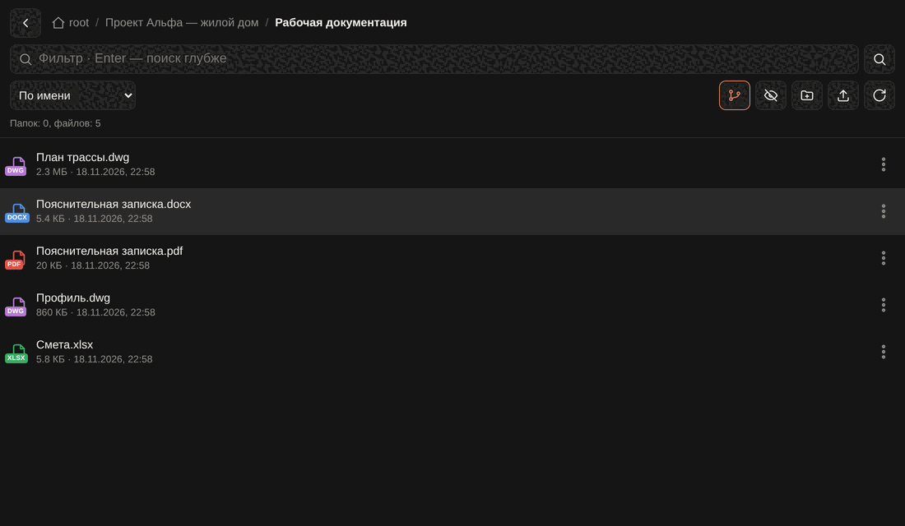
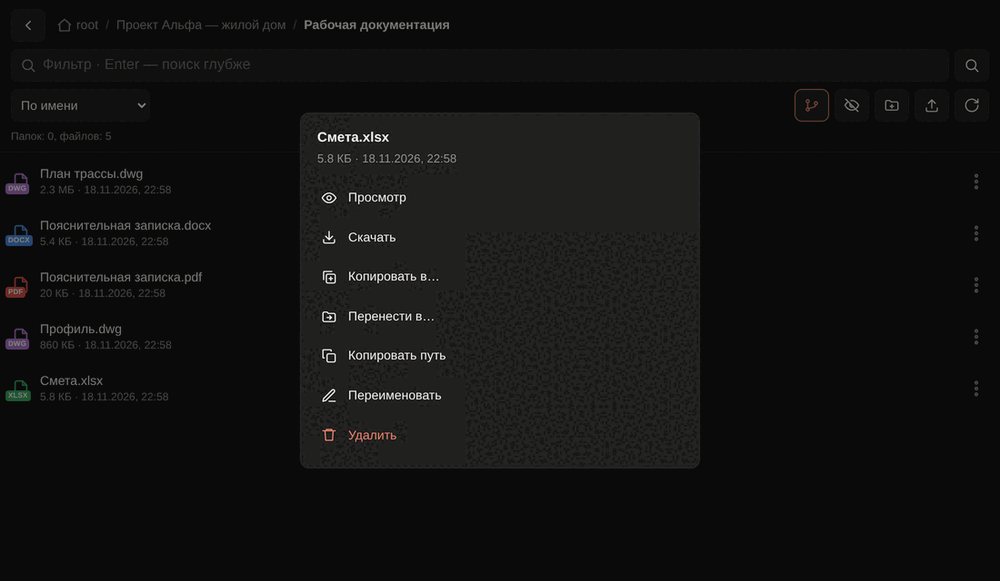
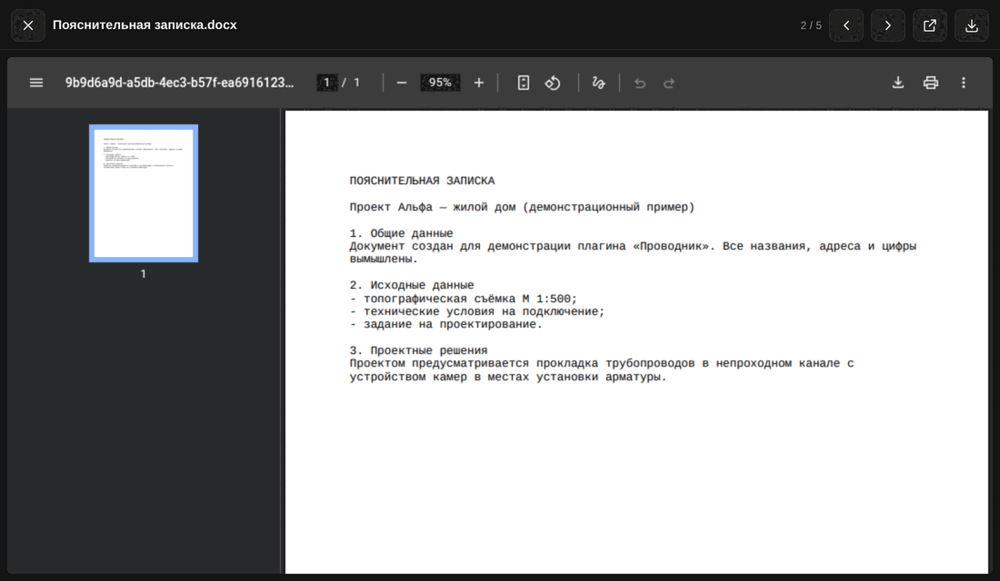
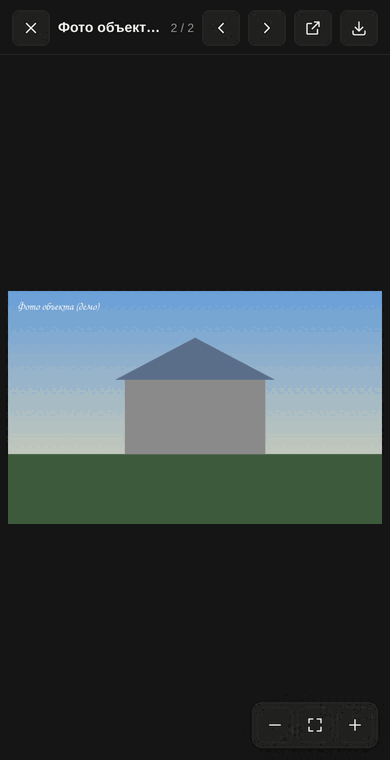

# Проводник — плагин CloudCLI

Вкладка для [CloudCLI](https://github.com/siteboon/claudecodeui) (веб-интерфейс Claude Code),
которая показывает файлы проекта **по одной папке за раз**.

Встроенная вкладка «Файлы» загружает всё дерево проекта целиком и на больших архивах
останавливается с ошибкой «Project file tree exceeds the 10,000 entry limit». Проводник
запрашивает только открытую папку, поэтому размер проекта ему не важен, а на телефон уходит
пара килобайт вместо всего дерева.



## Возможности

**Навигация**
- хлебные крошки, кнопка «Вверх», сортировка: по имени, сначала новые, сначала большие;
- фильтр по открытой папке; **Enter** — поиск по имени во всех вложенных папках;
- учёт `.gitignore` так же, как в git (корневой и вложенные файлы, `!`-исключения);
  переключатель в панели, в статусе видно, сколько записей скрыто;
- скрытые файлы (начинающиеся с точки) — отдельным переключателем.

**Просмотр**
- картинки, PDF, видео, аудио, текст — прямо в браузере;
- документы Word, Excel, PowerPoint, LibreOffice — конвертируются на сервере в PDF;
- чертежи DWG и DXF — отрисовываются на сервере в векторную картинку;
- TIFF, HEIC, PSD — конвертируются в JPEG;
- листание файлов папки, масштаб и перетаскивание картинок и чертежей.

**Действия с файлами**
- скачивание любых файлов и **«Скачать ZIP»** для папки — архив собирается на лету,
  без ограничений по размеру (ZIP64), имена в UTF-8;
- **«Копировать в…»** и **«Перенести в…»** с выбором папки и разрешением конфликтов имён;
- загрузка файлов в открытую папку, новая папка, переименование, удаление;
- «Копировать путь» — чтобы вставить путь к файлу в чат Claude.

Без зависимостей и без сборки: интерфейс (`dist/index.js`) и сервер (`dist/server.js`) —
обычные ES-модули, `npm install` не нужен.

| Меню файла | Просмотр документа | Телефон |
| --- | --- | --- |
|  |  |  |

## Установка

**Требования:** CloudCLI с поддержкой плагинов (проверено на 1.37.9) и Node.js 22.2 или новее.

В CloudCLI откройте **Settings → Plugins**, вставьте ссылку на репозиторий и нажмите **Install**:

```
https://github.com/jav1dan/cloudcli-plugin-explorer
```

Или вручную — от имени пользователя, под которым работает CloudCLI:

```bash
git clone https://github.com/jav1dan/cloudcli-plugin-explorer.git \
  ~/.claude-code-ui/plugins/cloudcli-plugin-explorer
```

Обновите страницу CloudCLI — появится вкладка «Проводник». Перезапускать CloudCLI не нужно:
сервер плагина стартует сам при первом запросе.

Папка плагина должна быть настоящей, а не симлинком: симлинки CloudCLI пропускает.

**Обновление:** кнопка **Update** в Settings → Plugins или `git pull` в папке плагина.
Если сервер плагина уже запущен, он подхватит новую версию после перезапуска CloudCLI или
после завершения его процесса (`pkill -f cloudcli-plugin-explorer/dist/server.js`) — тогда
он стартует заново при следующем запросе.

## Как пользоваться

| Действие | Как |
| --- | --- |
| Открыть папку или файл | клик по строке (или Enter на ней) |
| Меню файла или папки | кнопка **⋮** справа в строке |
| Искать во вложенных папках | ввести часть имени и нажать **Enter** (или кнопку поиска) |
| Следующий / предыдущий файл в просмотре | **→** / **←**, кнопки ‹ ›, на телефоне — свайп |
| Увеличить картинку или чертёж | колесо мыши, щипок, двойной клик, кнопки − ⤢ + |
| Закрыть просмотр | **Esc** или ✕ |

Скачивание файлов и ZIP идёт через загрузки браузера, поэтому прогресс виден там же,
а размер файла не ограничен памятью вкладки. Копирование и перенос выполняются в фоне,
прогресс — в строке статуса внизу.

При совпадении имён в «Копировать в…» и «Перенести в…» плагин предлагает **«Заменить»**
(только файл файлом) или **«Сохранить оба»** — новая копия получит « (2)» в имени.

## Просмотр документов и чертежей

Форматы, которые браузер не показывает сам, сервер плагина конвертирует программами,
установленными на машине с CloudCLI. Все они необязательны: без них остальное работает,
а такой файл предлагается скачать.

| Формат | Показывается как | Что установить (Debian / Ubuntu) |
| --- | --- | --- |
| doc, docx, rtf, odt, xls, xlsx, ods, ppt, pptx, odp, vsd и др. | PDF | `libreoffice-core libreoffice-writer libreoffice-calc libreoffice-impress`, шрифты `fonts-liberation fonts-crosextra-carlito fonts-crosextra-caladea` |
| dwg, dxf | SVG | `python3-ezdxf` и конвертер DWG → DXF (см. ниже) |
| tif, tiff, heic, heif, psd | JPEG | `imagemagick` (для HEIC нужна поддержка `libheif`) |

### DWG

DWG сначала переводится в DXF, затем `dist/tools/dxf2svg.py` (на [ezdxf](https://ezdxf.mozman.at/))
рисует его на белом фоне. Для перевода плагин пробует по очереди:

1. **[ODA File Converter](https://www.opendesign.com/guestfiles/oda_file_converter)** —
   бесплатный, но со своей лицензией, которую нужно принять при скачивании. Читает
   практически все DWG: на выборке реального архива проектов отрисовались 29 чертежей из 30.
2. **[LibreDWG](https://www.gnu.org/software/libredwg/)** (`dwg2dxf`) — свободный, но читает
   не все файлы: на той же выборке — около 60 %.

ODA File Converter — приложение Qt с поддержкой только X11, поэтому на сервере без экрана
ему нужен виртуальный дисплей:

```bash
sudo apt install ./ODAFileConverter_QT6_lnxX64_11dll_<версия>.deb xvfb xauth libopengl0
```

### Кэш и ограничения

- Готовый просмотр хранится в `~/.cache/cloudcli-explorer/preview` (до 2 ГБ, давно
  не открытые удаляются первыми), ключ — путь, размер и время изменения файла. Повторное
  открытие мгновенное; изменённый файл конвертируется заново.
- Каждый шаг конвертации ограничен 3 минутами; файлы больше 300 МБ не конвертируются.
- Неудачная конвертация запоминается на 10 минут, чтобы не повторять тяжёлую работу.
- Встроенный PDF-просмотрщик браузера показывает в заголовке служебное имя, а не имя
  файла — для скачивания используйте кнопку плагина.

## Вместо встроенной вкладки «Файлы» (по желанию)

CloudCLI не умеет скрывать или переставлять вкладки, но это делается стилем: ряд вкладок —
flex-контейнер, а кнопка плагина подписана его `displayName`. Этот CSS скрывает «Файлы»
и ставит «Проводник» на её место, после чата и терминала. Если плагин отключён,
селекторы ничего не находят, и вкладки остаются как были.

```css
[role="tablist"]:has(> div > [role="tab"][aria-label="Проводник"]) > *{order:3}
[role="tablist"]:has(> div > [role="tab"][aria-label="Проводник"]) > :nth-child(-n+2){order:0}
[role="tablist"]:has(> div > [role="tab"][aria-label="Проводник"]) > div:has(> [role="tab"][aria-label="Проводник"]){order:1}
[role="tablist"]:has(> div > [role="tab"][aria-label="Проводник"]) > div:has(> [role="tab"] svg.lucide-folder){display:none}
```

Собранный JS CloudCLI браузер кэширует на год, поэтому стиль удобнее вставлять прокси
в `index.html`, который CloudCLI отдаёт без кэша. Пример для nginx — в `location`,
который проксирует CloudCLI:

```nginx
proxy_set_header Accept-Encoding "";
sub_filter_once on;
sub_filter '</head>' '<style>…стиль выше одной строкой…</style></head>';
```

Встроенная вкладка остаётся доступной через палитру команд (Ctrl+K → «Files»).

## Если что-то не так

| Симптом | Что проверить |
| --- | --- |
| Вкладка «Проводник» не появилась | папка плагина — не симлинк; плагин включён в Settings → Plugins; страница обновлена |
| «Сессия CloudCLI истекла» | обновите страницу и войдите заново |
| Документ не открывается: «не установлен soffice» и т. п. | установите программы из таблицы выше на машину с CloudCLI |
| Первый документ Office открывается дольше остальных | при первом запуске LibreOffice создаёт свой профиль в кэше — это несколько секунд, один раз |
| Чертёж «не удалось отрисовать» | установите ODA File Converter; при уже установленном файл, скорее всего, повреждён |
| После обновления плагина ничего не изменилось | перезапустите сервер плагина (см. «Обновление») и обновите страницу |

## Как это устроено

CloudCLI запускает `dist/server.js` от имени своего пользователя (один процесс на пользователя)
и проксирует к нему `/api/plugins/explorer/rpc/*`. Тело запроса хост передаёт только как JSON.

| Запрос | Назначение |
| --- | --- |
| `GET /list` | содержимое папки (с учётом `.gitignore` и скрытых файлов) |
| `GET /search` | поиск по имени во вложенных папках |
| `GET /raw` | файл целиком; `download=1` — как вложение |
| `GET /preview` | конвертированная копия для просмотра; `202` — «ещё готовится, спросите снова» |
| `GET /zip` | папка потоковым ZIP-архивом |
| `POST /transfer`, `GET /job` | копирование и перенос фоновой задачей, её прогресс |
| `POST /mkdir`, `/rename`, `/delete` | новая папка, переименование, удаление |
| `POST /upload`, `/upload-cancel` | загрузка файла частями, отмена |

Подробности:

- **Безопасность.** Каждый запрос несёт корень проекта, и пути не могут выйти за него
  (`../`, абсолютные пути). Сервер работает с правами пользователя CloudCLI, так что права
  файловой системы соблюдаются как есть. Удаление симлинка удаляет только ссылку.
- **Авторизация.** Интерфейс обращается к серверу через `fetch` с токеном CloudCLI
  в заголовке `Authorization`. Скачивание — обычная загрузка браузера по ссылке, которая
  несёт токен в `?token=` (так же CloudCLI подключает свои WebSocket).
- **Загрузка** идёт base64-частями по 4 МБ во временный скрытый файл, который
  переименовывается в настоящий после последней части.
- **ZIP** пишется потоком с дескрипторами данных. Уже сжатые форматы (pdf, jpg, docx,
  xlsx, rar…) кладутся без сжатия, остальные — deflate. Поля ZIP64 появляются только там,
  где значение не помещается в 32 бита, поэтому обычные архивы открываются везде.
- **Копирование и перенос** — фоновые задачи: прокси вроде Cloudflare не ждут ответа
  дольше 100 секунд. Перенос между точками монтирования выполняется копированием
  и удалением исходника; симлинки копируются как ссылки, время изменения сохраняется.
- **Конвертация** идёт в отдельной группе процессов, чтобы по таймауту завершались и все
  дочерние процессы. LibreOffice работает по одному файлу со своим профилем в кэше,
  остальные конвертеры — по два одновременно. Если конвертация дольше 45 секунд, сервер
  отвечает `202`, и интерфейс повторяет запрос к той же задаче. ODA File Converter
  запускается под `xvfb-run -a` и получает копию файла — симлинки он пропускает.
  `dxf2svg.py` рисует пространство модели (или самый заполненный лист, если модель пуста)
  и исправляет типичные дефекты DXF от LibreDWG: переводы строк внутри значений и записи
  таблиц без имени.
- **Поиск** — обход в ширину с ограничениями: 5 секунд, 300 000 записей, до 200 результатов.
  Папки, исключённые `.gitignore`, поиск не обходит.
- **`.gitignore`** разбирает библиотека [`ignore`](https://github.com/kaelzhang/node-ignore)
  7.0.16 — та же, что в самом CloudCLI. Она вложена в `dist/vendor/`.

## Структура

```
manifest.json          описание плагина для CloudCLI
icon.svg               иконка вкладки
dist/index.js          интерфейс вкладки
dist/server.js         сервер плагина
dist/tools/dxf2svg.py  отрисовка DXF в SVG (ezdxf)
dist/vendor/           библиотека ignore (MIT)
docs/screenshots/      скриншоты для README (на вымышленных данных)
```

## Лицензия

[MIT](LICENSE). Вложенная библиотека `ignore` — MIT, см. `dist/vendor/ignore.LICENSE-MIT`.
ODA File Converter, LibreOffice, LibreDWG, ezdxf и ImageMagick в плагин не входят и
распространяются под своими лицензиями.
